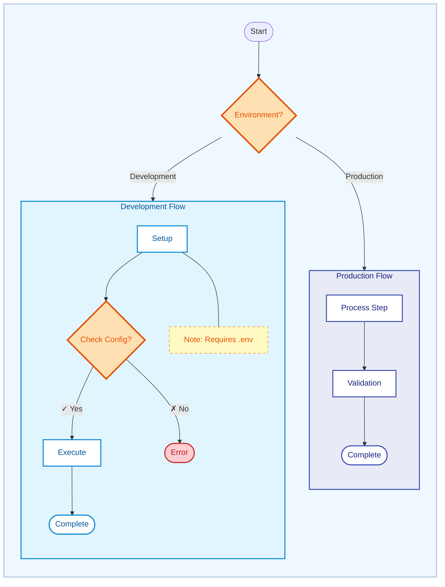

# Diagram Accessibility & WCAG Compliance

Apply WCAG contrast criteria to the rendered diagram. A palette alone does not establish conformance.

## Color Palette

Use these colors as starting points. Adjust any pair that fails the checks below.

| Purpose | Background | Border | Text |
|---------|------------|--------|------|
| Production | `#E8EAF6` | `#3F51B5` | `#1A237E` |
| Development | `#E1F5FE` | `#0288D1` | `#01579B` |
| Testing | `#E8F5E9` | `#43A047` | `#1B5E20` |
| Error/Warning | `#FFCDD2` | `#C62828` | `#B71C1C` |
| Decision | `#FFE0B2` | `#E65100` | `#E65100` |
| Info | `#E0F7FA` | `#00ACC1` | `#006064` |
| Notes | `#FFF9C4` | `#F57C00` | `#E65100` |

Check rendered text against its actual background: normal text needs 4.5:1 and large text 3:1. See [WCAG text contrast](https://www.w3.org/WAI/WCAG22/Understanding/contrast-minimum.html). Essential graphical boundaries need 3:1 against adjacent colors under [non-text contrast](https://www.w3.org/WAI/WCAG22/Understanding/non-text-contrast).

---

## Styling Rules

1. **Quote all labels**: `id["Label"]` not `id[Label]`
2. **Multiple visual cues**: Shape + color + text + borders (never color alone)
3. **Stroke width**: 2px standard, 3px for decision diamonds
4. **Decision paths**: Use `|✓ Yes|` and `|✗ No|` symbols
5. **Subgraph styling**: Use direct `style SUBGRAPH_ID fill:...` (not `classDef`)
6. **White nodes**: Force `fill:#FFFFFF` inside colored subgraphs (except Notes)
7. **Nested subgraphs**: Lighter backgrounds, thinner borders (1px) for children
8. **Note nodes**: Dashed borders (`stroke-dasharray: 5 5`), amber text
9. **Outer container**: Wrap complex diagrams in pastel container (`fill:#F0F8FF`)
10. **Comments**: Always comment styling sections for maintainability

---

## Template

---

## Anti-Patterns

Do not infer accessibility from a palette name, default theme, or color-blindness simulation alone. Check rendered contrast and preserve shape, text, and border cues.

---

## Related Skills

- [basic-documentation.md](../basic-documentation/SKILL.md) - Documentation standards and conventions

---

## Checklist

- [ ] Text and essential graphical boundaries meet the applicable contrast minimum
- [ ] Info conveyed via shape + text + borders (not just color)
- [ ] All labels quoted
- [ ] Palette adjusted where measured contrast fails
- [ ] 2px borders (3px for decisions)
- [ ] Styling sections commented
- [ ] Tested with color blindness simulator ([Coblis](https://www.color-blindness.com/coblis-color-blindness-simulator/))

---
